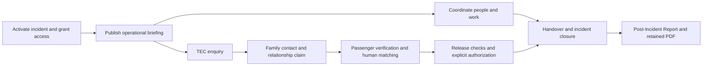

# Comprehensive post-Foundation product audit

Assessment date: **29 September 2026**. Application baseline: merged Stage 25
`2d47bc008a40d66c04ea4b54912731ef85a790a1`; inspected checkout:
`agent/local-preview`, `efc633a`. This is an assessment, not an implementation plan
approved for execution. No new Foundation stage or Product Increment was started.

## 1. Executive summary

**ZPP Connect is a substantial operational application with unusually strong durable
workflow controls, but it is not yet a production-ready crisis-response experience.**
It is suitable for structured synthetic evaluation. Readiness for real operational
use requires both a short product-correctness increment and a separately owned
production-delivery workstream. A broad architectural rewrite is not warranted.

The strongest areas are explicit human decisions in matching/release, controlled
requests and assignments, incident-scoped server authorization, document versions
and acknowledgements, immutable approved reports, and PostgreSQL-backed evidence
and recovery. The weak point is translating these capabilities into an accurate,
quickly understandable operational picture for each role.

Five highest-priority findings:

1. **Unavailable information becomes reassuring zeroes.** TEC, group leader,
   member and observer dashboards show zero/clear metrics when the aggregate is
   omitted by authorization. TEC simultaneously sees an urgent request below
   “Needs attention 0”. This is a correctness problem before it is a design problem.
2. **An owner can be unable to perform the assigned work.** The seeded urgent
   request belongs to the ZPP Group Leader, whose Requests page/API return
   forbidden. The assignee API and write validation accept active incident
   assignees without checking their request capabilities.
3. **The production browser sign-in flow is unfinished.** With development access
   disabled, “Continue with Microsoft” only displays “This sign-in method is not
   available yet.” API Entra validation and production startup checks do not
   establish an end-to-end browser login.
4. **Operational context and freshness are fragmented.** Briefing authority and
   age, personal work, team coverage, urgent casework and required acknowledgements
   are on separate pages. The persistent header mainly identifies a Session code.
5. **Shipping/recovery evidence is incomplete.** Development Compose is not a
   production deployment; image contents, SPA deep-link serving, native backup
   utilities, real Entra integration, off-host recovery and monitoring need an
   explicit deployment acceptance gate.

Recommended next product task: **Product Increment 1 — Trustworthy operational
status and actionable ownership**. Then evolve the existing landing page and
Active Event into one Incident Workspace. This narrows and resequences the previous
“Incident Workspace UX & Operational Flow” proposal rather than accepting it by default.

### Method and evidence boundaries

The audit began in the running product at `http://localhost:5173`, backed by local
PostgreSQL `zpp_connect_preview`, `AUTH_MODE=dev`, `PERSISTENCE_MODE=postgres`.
Liveness/readiness returned 200. Browser connection discovery returned no available
browser; installed Playwright Chromium was used against the real API, not a memory
adapter. Source review followed the initial live persona survey.

- All six accounts signed in; `/auth/me` confirmed actual roles and permissions.
- All 23 principal application routes were visited under each account: **138
  route/persona observations**, including intentional forbidden screens.
- Forms, record drawers, briefing, document content, notifications, approved AAR,
  evidence withdrawal confirmation and admin tabs were inspected. Draft forms
  were closed without submitting operational changes.
- Seven representative pages were measured at **1440, 1280, 1024 and 768px**.
  Screenshots were visually reviewed, including briefing, narrow Timeline and
  laptop Documents. This is not a claim that every page was checked at every width.
- Keyboard entry, row activation, dialog Tab cycling, Escape, focus restoration
  and narrow navigation were exercised. No assistive-technology certification or
  complete contrast audit was performed.
- Browser-only response interception safely simulated unavailable Dashboard,
  missing visible incidents, request network failure/delay, evidence integrity
  failure and production login configuration. Offline navigation was also tested.
  These simulations did **not** alter database integrity or backend behavior.
- Direct API checks confirmed anonymous 401, admin authorization differences,
  request-owner candidates and evidence read permissions. No penetration-test or
  comprehensive cross-incident exploit claim is made.
- Existing approved report/PDF and evidence were inspected; prior preview
  verification downloaded CSV/PDF/evidence and verified evidence SHA-256. This
  audit did not re-execute every terminal lifecycle transition or full CI/recovery
  suite. Test source/configuration is distinguished from tests run here.
- No real users, operational data, credentials or Entra tenant were used. Login
  and read/download audit entries may be generated by inspection. The preview is
  interactive; timestamps, read flags and artifact counts can change during use.

Screenshots, text snapshots, scripts and JSON results remain **uncommitted** in
`storage/product-audit/`. Findings below include reproduction steps and source
pointers so the document does not depend on those local files surviving.

### Evidence index

| Evidence | What was actually observed / inspected |
| --- | --- |
| E01 | Six-persona survey: `storage/product-audit/{persona}/{route}.txt`, screenshots and `survey.json`; actual `/auth/me` in each `identity.json`. |
| E02 | Dashboard: coordinator 2 passengers/5 attention items; TEC 0/clear while urgent request and two family items remain visible; leader/member/observer 0/clear. |
| E03 | Active Event: published revision, source-labelled facts, unconfirmed item, linked assignments, risks, absolute publication/next-update dates and history. |
| E04 | Requests: urgent assigned fixture, record drawer/actions, API assignee candidates and denied ZPP access in `api-rbac.json`. |
| E05 | Assignments: four rows, three active/overdue, member's own task editable, others view-only; personal/queue/board modes. |
| E06 | Notifications after awaiting the list response: distinct action/update sections; member's overdue assignment and document acknowledgement; leader's three document actions. Initial pre-response empty snapshots were not treated as final results. |
| E07 | Documents: published v2.0, older versions, requirement targets, acknowledgement history; member has a focused “My documents” view. |
| E08 | TEC/family new/edit forms, Matching suggestions/decisions, empty Release Control; `deep/*` snapshots. |
| E09 | People: member directory, scoped Alpha group for leader, six roster fixtures and period filters. |
| E10 | Evidence: real retained text record, SHA-256/NOT_CONFIGURED display, download/withdraw controls; observer API 403 and operational readers 200. |
| E11 | Reports export choices; AAR independent historical selector, approved disabled fields, revision and retained PDF controls. |
| E12 | Admin Users/Roles/Settings and Organizations/Invitations/Dictionaries tabs; protected versus configurable values. |
| E13 | `deep/responsive-*-layout.json`: document width never exceeded viewport in 28 samples; Timeline table 1400px, 692px container at 768/1024; Documents sub-tables 820/760px inside 448px columns at 1280. |
| E14 | `accessibility/`: request modal focus remained inside through 18 Tabs; Escape restored New Request after animation frame; Enter opened request row; narrow menu navigation worked. Timeline search has placeholder but no explicit label. |
| E15 | `states/`: 503 Dashboard, network/offline errors, empty incident list, simulated integrity failure and unauthenticated redirect. |
| E16 | `targeted/production-login-simulated.*` plus [LoginPage](../apps/web/src/pages/LoginPage.tsx): Microsoft button sets notice, no production token acquisition. |
| E17 | Source: [production composition](../apps/api/src/routes/production-composition.ts), [EffectiveAccess](../apps/api/src/modules/identity/effective-access-service.ts), module routers/repositories and Prisma schema. |
| E18 | Three npm audit JSON reports, lockfile flags and `dependency-paths.txt`; all eight findings dev-only; both production audit variants zero. |
| E19 | [CI](../.github/workflows/ci.yml), existing unit/integration/browser test source, [backup](runbooks/backup.md) and [restore](runbooks/restore.md) runbooks, Dockerfiles/Compose. Not a new execution of the full gates. |
| E20 | Safe synthetic search `AUDIT-SYNTHETIC-QUERY` appeared in API log `req.url` and `req.query`; source redacts selected field names but not arbitrary query values. |
| E21 | Preview mismatch: Matching claim still says original fixture passenger name and LO3924 while passenger is renamed Synthetic/LO999; preview seed modifies current records without corresponding claim/suggestion refresh. |

## 2. Product purpose and boundary

The product should support a **real incident response**, including coordination,
controlled family/passenger assistance, personnel coverage, operational guidance,
evidence and retained post-incident reporting. It should help people decide and
act with an explicit incident, authority, owner and record of what happened.

It is not an airline-wide employee system, enterprise document management suite,
project portfolio tool, generic BI product, training LMS, exercise platform or
organisational readiness scorecard. The specialized TEC/family/passenger chain is
a major workflow within that boundary; it must not be mistaken for the entirety
of crisis coordination.

`REAL` is the current supported creation mode. The reviewed PostgreSQL data is
fictional. Legacy Training/Exercise schema and recovery compatibility do not
justify reactivating those product areas. Technical `/health/readiness` is service
health, not workforce/organisational readiness.

## 3. Overall assessment

| Perspective | Assessment | Why |
| --- | --- | --- |
| Product usefulness | Substantial, evaluable | Work can be recorded, assigned, verified and retained; many important domains already exist. |
| Operational workflow | Capable but fragmented | Domain controls are clearer than cross-page responsibility and handover. One concrete ownership dead end exists. |
| UX / information architecture | Usable by trained users, not yet dependable under time pressure | Good controls and explanatory text compete with technical prose, generic metrics and inconsistent terminology. |
| Technical architecture | Sound modular monolith with local debt | Real production composition, scoped services, transactions and recovery; mixed frontend contracts and older compatibility code remain. |
| Production maturity | Not ready for a real-data pilot without explicit gates | Browser sign-in incomplete; deployment image/recovery assumptions and operational policies not proven. |

No arbitrary numerical maturity score is assigned. A passing migration or backend
integrity suite does not establish operator effectiveness, deployment integration,
privacy approval or production availability.

## 4. Persona assessment

The six identities below were confirmed from the live API, not copied only from
seed documentation. Admin carries three roles, so its behavior must not be
attributed to `system-admin` alone. Leader role assignment is scoped to Family
Assistance Alpha; system authorization and operational group membership differ.

| Persona | Landing / navigation / actions | Information and responsibility | Main dead end / permission clarity |
| --- | --- | --- | --- |
| Coordinator — `zpp-coordinator` | Command, seven Case Work destinations, four People destinations, Documents/Evidence, Settings, Import/Reports/Audit. Can create/manage operational records and briefing. | Sees real casework totals and urgent rows; must open other pages for own overdue work, briefing age and staffing. | Admin heading contains legitimate operational tools although account administration is forbidden. Incident is principally a code outside Active Event. |
| Admin — `system-admin`, `zpp-coordinator`, `tec-coordinator` | Same operational landing plus Users & Access and Roles & Permissions. | Broad management capability; admin work has no separate starting view. | Role combination obscures why a capability is present. Settings is descriptive; dictionaries/organizations are under Users & Access. |
| TEC — `tec-member` | TEC Intake, Family/NOK, Requests, Timeline; roster/assignments; documents/evidence. No passenger/matching/release/admin tools. | Dashboard says clear despite permitted urgent request. Intake safeguards and redaction are useful. Starter steps omit direct “take/record enquiry” action. | Cannot act on restricted family details; inline `[restricted]` is accurate but noisy. Evidence download is allowed and needs a documented content-sharing policy. |
| Leader — `zpp-group-leader` | People/own group, assignment work, briefing, documents/evidence; no Case Work. | Alpha group scope is visible in Groups, but dashboard is all zeroes. Three document actions appear in bell. | Owns seeded urgent request yet Requests is forbidden. Clarify owner suitability, not privilege expansion. |
| Member — `zpp-member` | Own assignment actions, people/group/roster read views, briefing, personal documents, evidence. | Personal document page works well. Default assignment queue still shows all four tasks, while only own row can be changed. Dashboard does not expose own overdue task. | “Clear” conflicts with overdue assignment/document notifications. General casework shorthand dominates a non-casework role's landing. |
| Observer — `observer` | Briefing, Sessions, roster, Documents, Settings. Evidence and Case Work unavailable. | Read-only posture mostly clear. Documents shows organization-level requirements/acknowledgements, not a personal obligation. | Zero incident metrics imply knowledge the role does not have. “To acknowledge 16” and management copy can imply work expected from the observer. |

### The four operational questions

| Question | Coordinator | TEC | Leader | Member | Observer |
| --- | --- | --- | --- | --- | --- |
| Situation: incident/status/latest authority/recent change? | Available after opening Active Event; no compact landing summary of changes. | Same briefing access; dashboard aggregates misleading. | Briefing useful; generic zeroes add no reliable context. | Briefing useful; repeated casework metrics irrelevant. | Briefing is the correct destination; zeroes should not stand in for restricted facts. |
| Responsibility: mine/team/overdue/blocked/acknowledgements/decisions? | Split across Assignments, Requests, Documents, roster and casework. | Intake queue plus assignments; no unified personal responsibility. | Groups helps team scope; inaccessible request ownership is a failure. | Own work visible after entering the right page; bell helps. | Should be explicitly “no assigned actions”, not an implied clear incident. |
| Coordination: owner/state/decision/reason? | Strong inside request, matching and release contexts; weaker at aggregate level. | Handover and redacted family context need clearer next-owner links. | Team membership is clear; task/request distinction and legacy labels weaken ownership. | Can see others' task status, act on own; no team handover digest. | Readable briefing/roster; should not infer decisions from technical metadata. |
| Handover: could another operator take over quickly? | Possible using briefing + tasks + requests + timeline, not in seconds. | Must reconstruct enquiry, family and action context across pages. | No “covering now + outstanding team actions” view. | Personal task/documents are recoverable; blocked dependencies are dispersed. | Authoritative briefing sufficient for observation if freshness is explicit. |

This is an expert walkthrough, not timed research with crisis professionals.
“Within a few seconds” is not empirically validated; the required page switches
and observed contradictions show why that criterion is not yet met.

## 5. End-to-end operational journey

Documents, timeline and evidence support multiple steps; they are not sequential
stages everyone must visit. Notifications direct the operator to the owning
workflow rather than completing its work.

Activation exists through Sessions and incident access assignments. Briefings
provide authoritative coordination. Requests and Assignments manage different
kinds of work. The family chain preserves distinctions between reported facts,
relationship verification, match suggestion, human confirmation and release.
Closure requires a dedicated action/note; reporting is associated with closed
incidents. The principal missing connection is an explicit handover view over
existing records, not another persistence domain.

Reproduction: coordinator Dashboard → Active Event → linked assignment → Requests
→ Timeline; compare the incident code, task status and briefing priority at each
stop. The same task is visible in several places with different status framing.
The data is connected, but navigation does not carry a coherent “continue this
work, then return here” journey through all modules.

## 6. Information architecture

### Current information architecture

| Group | Routes (permission-dependent) |
| --- | --- |
| Command | Dashboard `/dashboard`; Active Event `/active-event`; Sessions `/sessions` |
| Case Work | TEC Intake `/tec-intake`; Family / NOK `/family-nok`; Passenger / SRC `/passenger-src`; Matching `/matching`; Release Control `/release-control`; Requests `/requests`; Timeline `/timeline` |
| People | Members `/members`; Groups `/groups`; Rostering `/rostering`; Assignments `/assignments` |
| Operations | Documents `/documents`; Incident Evidence `/evidence` |
| Account | Settings `/settings` |
| Admin | Files / Import `/files-import`; Reports `/reports`; Users & Access `/users-access`; Roles & Permissions `/roles-permissions`; Audit `/audit` |
| Nested / global | AAR `/reports/after-action` from Reports; notification bell; account menu. Organizations, invitations and dictionaries are tabs inside account administration. |

The grouping follows implementation history more than operational intent:
assignments are under People, an incident-wide timeline under Case Work, operational
reports/imports under Admin, and the main briefing behind Active Event. Twenty-three
routes are not inherently too many; the problem is unclear entry points and uneven
relationship between navigation, role and workflow.

### Recommended information architecture

| User-facing group | Recommended destinations and rationale |
| --- | --- |
| Incident | Incident Workspace; Briefing; Activity timeline. Workspace is the primary operational landing; briefing retains a full authoritative view. |
| My work / Team work | Existing Assignments (“Tasks”) and Support requests, initially distinct queues or tabs. No replacement task engine. Show only applicable destinations. |
| Family & passenger support | Enquiries → Family contacts/claims → Passengers → Matching → Release/reunification. Retain specialist boundaries and contextual transitions. Put manifest import here for authorized roles. |
| Response team | Members, Groups, Roster/availability; role-specific current coverage view. |
| Operational records | Documents, Incident evidence, Exports. |
| Incident register / Review | Incidents and historical Post-Incident Reports, with explicit historical context. |
| Administration | Accounts, roles/access, organizations, operational dictionaries, audit. Distinguish authorization changes from operational team membership. |
| Global utilities | Notifications and account/profile preferences. |

Do not introduce all these as expanded top-level groups simultaneously. Prototype
progressive disclosure against the six personas. Preserve URLs initially; vocabulary
and navigation changes do not require renaming database models.

## 7. Dashboard

| Element | Question it answers | Assessment |
| --- | --- | --- |
| Large Start here panel | “Where should I begin?” | Useful onboarding, dismissible, but occupies most of the first screen. Static ordered steps are not current operational priority; TEC does not get intake as its primary step. |
| Shorthand glossary | “What do TEC/PAX/SRC mean?” | Useful help, poor permanent prominence for all roles. Move to contextual help after onboarding. |
| Manifest / processing / matching cards | “How far along is family/passenger reconciliation?” | Valuable for authorized specialist coordination, not universal crisis status. Missing values must not become zero. |
| Needs attention | “What is urgent?” | Valuable goal; current count is built from conditional aggregate fields, separate from visible priority rows. Observed contradiction undermines trust. |
| Coverage and matching chart | “What fraction is processed?” | Secondary analytic detail; duplicates cards and remains visible to roles without the underlying data. |
| Current Attention links | “Which record should I act on?” | Strongest action-driving section. However it is below onboarding/charts and omits personal task/document obligations. |
| Data Quality | “What missing source information blocks progress?” | Useful for an authorized casework role; “clear” is invalid when unavailable rather than assessed. |

The concrete failure is in the contract: [production-shared-router](../apps/api/src/routes/production-shared-router.ts)
only creates richer aggregates when all seven relevant permissions are present;
[DashboardPage](../apps/web/src/pages/DashboardPage.tsx) defaults absent objects/numbers
to zero. Authorized priority rows are generated independently. Treat this as a
reproducible defect, not a preference about cards.

**Decision:** evolve the operational landing into an **Incident Workspace**.
Keep specialist reconciliation metrics as an authorized subsection/view; do not
create a second competing universal Dashboard. Retain full Briefing as a distinct
authoring/history page linked from the workspace. Fix truthfulness first, then
compose name/status, briefing freshness, personal/team actions and material changes.
The current dashboard is not a sufficient CMT overview and should not acquire more
unrelated KPI cards to compensate.

## 8. Active Event / Briefings

The full briefing is one of the stronger screens: publication status, author,
confirmed information with sources, unconfirmed information, ordered priorities,
linked tasks, risks and coordination notes are separated. The right-hand published
briefing is visually prominent at desktop width. It is not just a timeline feed.

“Active Event” undersells what the page does and competes with Session/Incident.
Use **Operational Briefing** or **Incident briefing**. Show a compact latest-briefing
summary and link on the Incident Workspace.

Publication and next-update timestamps are present, but overdue freshness is not
explicitly escalated. The synthetic fixture's June dates are a fixture limitation;
the UI's absence of a clear overdue/age signal when those dates are past is the
product finding. History offers revisions, not a reader-friendly change summary.
A linked Escalated/Critical assignment is summarized with “Linked task in progress”
and a separate “In progress” briefing badge. Another priority remains “Not started”
while its linked task is In Progress. These are separate authorities, but the
operator must decode their relationship.

Prefer a clear “briefing priority” versus “live task state” distinction, prominence
for escalation, and a short editorial “changes since previous briefing” convention.
Do not implement automatic diffing or a new decisions database without validating
that simpler briefing authoring guidance is insufficient. No global acknowledgement
requirement should be invented merely because the briefing can be read.

## 9. Timeline

Timeline is operational history, not AuditLog. A useful event answers: what happened,
when, who acted, why it matters, and where to continue. Audit history establishes
who executed a protected operation and what durable record changed.

Current strengths: chronological ordering, case/event/entity filters, decision-only
filter, read details, and manual note categories including handover. Dedicated
workflow decisions cannot be fabricated by selecting a manual note category.

Current weaknesses: `matchingRecord`, `StoredFile`, UUIDs and content hashes appear
in normal rows; ordinary event status is often “Not recorded”; actor is not a
leading column. The evidence-upload row exposes storage-oriented metadata rather
than a clear evidence link. At 768px the initial 692px viewport shows time/case/type/
status/trail while the actual event and details lie to the right in a 1400px table.
Even the 1440px page uses internal horizontal scrolling.

Make event title, meaningful summary, time, actor and linked record the primary
presentation. Move technical identity/metadata to details. Keep Audit separate and
role-gated. A notification can link to a timeline event; it should not cause every
technical audit entry to become a new operational alert. Preserve source events
and immutable decisions while changing presentation.

## 10. Requests

A Request is an **incident-scoped support need/commitment**: transport,
accommodation, interpreter, medical/welfare, communication or similar service.
Creation captures category, priority, requester, due date and requested action.
The drawer shows context and controlled Edit facts, Start, Wait, Priority, Assign,
Unassign, Resolve and Cancel actions. Resolution is a lifecycle command rather
than arbitrary status text. Related enquiry/family/passenger states remain distinct.

The queue has useful server filters and clear urgency/owner, but “Server queue”
and “incident-scoped operational commitment” are implementation language. First-row
purpose is hidden until opening the drawer; requested action deserves more weight
than a category alone. Completion versus cancellation is a useful distinction;
waiting should consistently explain what/who is blocking progress.

The important defect is actionable ownership. E04 reproduces assignment to the
leader despite `request:read` being absent. [Request repository](../apps/api/src/modules/requests/prisma-request-repository.ts)
`listAssignees` selects active incident users; assignment validation checks that
same membership, not effective request capabilities. Correct candidate selection
and write-side validation must agree, including later access revocation. Do not
resolve this by granting Requests to every member or observer.

Recommended term: **Support request**. Preserve its domain and linked context.
A generic **Task** (current Assignment) is a separate accountable action. Explain
that distinction where creating work; do not create another “Action” table.

## 11. Assignments

Assignments already form a usable work queue: individual ownership, unassigned
work, statuses, urgency, due dates, overdue counts, Queue/Board/Assigned to me,
controlled transitions and role-aware actions. The member can edit/start its own
seeded task but only view others. These capabilities should be reused.

The default all-owner queue contradicts guidance to start with Assigned to me.
It shows a member all four seeded tasks before its personal responsibility. Scope
must remain available for coordinators/leaders, but personal and team modes should
be deliberately chosen by role rather than inferred from a generic page.

Legacy owner “Leader Bravo” and linked free text such as `NOK-2026-001` illustrate
weaker references. Do not silently treat a legacy label as a current authenticated
owner. Display “legacy/unassigned owner—needs review” where appropriate. Overdue
counts are useful but the fixed fixture dates should not be mistaken for proof of
a date-calculation bug. Team handover needs task state, owner, blocker and next
step, not another kanban product.

## 12. Notifications

The bell implements an **in-app attention inbox** with Action required and Updates,
read/unread state, resolved projected items and source links. It is not a task
system. Awaiting the data response confirmed the leader's three document actions
and the member's overdue task/document action; early empty snapshots were loading
timing, not evidence of lost notifications.

Read is not completed: a read assignment alert can remain actionable until the
assignment changes. Resolved roster information can move to Updates. This is a
useful distinction worth preserving and explaining.

| Surface | What belongs there |
| --- | --- |
| Notifications | Personal delivery/read state and links to changes requiring attention; deduplicated reminders. |
| Needs attention | Current, permitted unresolved work/risks, regardless of whether its notification was read. |
| Timeline | Significant incident events and decisions in chronology. |
| Assignments / Requests | Authoritative owner, status, due date, blocker and completion. |

Do not count all unread notifications as outstanding tasks, or copy the same full
record into four views. Current document notices repeat generic text without the
document title; improve source labels and precise destinations. The Dashboard
should not say clear while a member has known projected obligations elsewhere.

## 13. Documents/checklists

Documents has substantial controls: explicit current published version, draft and
superseded history, role/group/member requirements, due dates, own versus on-behalf
acknowledgement and immutable acknowledgement evidence. “My documents” for the
member is a good model of a focused operational page.

The coordinator/observer library mixes reference, draft and archived records;
“Active” does not necessarily mean a published version exists. Global “To acknowledge
16” can be read as a personal obligation. Observer copy says “Manage…” despite its
read-only role. Manager requirements/acknowledgements tables expose MemberProfile,
actor UUID and legacy-evidence terminology. The laptop layout hides useful content
behind wide action columns.

Make **Required for me**, **Reference** and authorized **Manage versions/requirements**
explicit. Keep exact-version acknowledgement; reading guidance is not signing
that an operational checklist was executed. The seeded Airport Reception Checklist
is an archived document without published content, not an interactive runbook.
There is no demonstrated general checklist-execution workflow. Validate a specific
operational checklist need before adding one; do not generalize this into a DMS.

## 14. TEC/family/passenger workflow

The actual journey is more than six pages:

| Stage | Existing mechanism | Where continuity weakens |
| --- | --- | --- |
| Receive enquiry | Caller/context form; manual or known-passenger selection; warnings against disclosure; dedicated handover/controlled states. | Many fields and a manually entered Case ID; destination and next owner are not consistently visible in the queue. |
| Family follow-up | Contact information, immediate needs, commitments, next contact, assigned officer; independent relationship claim verification/rejection/correction. | Contact/context repeats across enquiry and family records; user must understand reported facts versus verified claim. |
| Passenger source work | Imported/recorded passenger, SRC/condition/hold controls. | SRC is specialist jargon; source confirmation, identity, condition and relationship must remain visibly independent. |
| Matching | Claim queue; explainable algorithm suggestions; explicit confirm/reject/manual selection; decision history. | Technical versions/generation IDs/server paging prose overwhelm the actual decision; a score can be visually overvalued. |
| Release/reunification | Prepared → checks → Authorized → Completed, with cancellation and upstream stale blockers. | Empty page says prepare from a human match but gives no prominent contextual route to resolve the prerequisites. |

Preserve the distinctions: an enquiry is not proof; linking a passenger does not
verify relationship; a suggestion is not a human decision; a verified match does
not authorize release. These are strengths, not bureaucracy to remove.

Improve one continuous case-support journey: carry incident/claimant/passenger
context, show next responsible role and blocking prerequisite, and retain return
to the same filtered queue. Reuse prefilling and existing links before proposing
a new Case aggregate. Validate repeated entry with coherent synthetic claims:
E21 is specifically a preview-seed mismatch, not evidence that the production
matching algorithm generated false signals. No real person is represented.

## 15. Members/Groups/Rostering

These are different objects with a defensible separation: a member is a personnel
profile; a group organizes incident response; a shift covers a time/location/function;
availability informs scheduling. A User and its roles authorize software access.
The same individual may have both a member profile and an account, but neither
membership nor roster assignment alone should grant system permissions.

The group leader sees the Alpha group and its six members, demonstrating meaningful
scope. Rostering offers bounded filters, status/confirmation actions and conflict/
unassigned warnings. However “Active shifts 4” means nonterminal lifecycle states,
not “four people covering now”: the preview's rows are in July. The label should
say that, and a current-period preset should answer who is on duty now. Do not
classify synthetic old dates as absent functionality; the semantic mismatch is
between a lifecycle aggregate and an operational coverage question.

A coherent path is member availability → group → shift → confirmation/coverage.
Expose that path and unfilled functions before adding staffing analytics. Keep
role assignment in administration; show explanatory links from operational profiles
without enabling leaders to modify unrelated authorization.

## 16. Evidence

Evidence is a bounded incident source register, separate from controlled guidance
Documents. Upload has file/category/description; download verifies retained bytes;
withdrawal preserves history and requires a reason. Incident and writable-state
checks occur before multipart parsing. Original bytes and metadata are committed
in PostgreSQL together. These are strong foundations.

Normal users currently see PostgreSQL storage language, a full SHA-256, scan enum
`NOT_CONFIGURED`, “withdrawn tombstones” and integrity/signature explanations. Show
filename, category, description, uploader/time, availability and withdrawal reason
first. Use plain “Malware scanning is not enabled” with an appropriate operational
instruction; never replace it with “safe”. Put digest/size/verification details in
an expandable technical section; keep storage keys, operation IDs and transaction
metadata audit-only. Hashes establish retained-byte consistency, not authenticity.

TEC, leader and member can download incident evidence; observer cannot. This was
confirmed via UI and API. Files cannot be field-redacted like records. Therefore
approve an incident-wide evidence-sharing/content policy before real data; do not
assume every uploaded file is suitable for every evidence reader. A broader per-file
ACL system is not justified without that policy decision.

The simulated integrity error correctly blocks the download and displays the
failure. Add an actionable instruction to contact the designated incident/system
administrator; never silently serve mismatched bytes.

## 17. Reports/Exports

Reports is primarily an **export launcher**, not a reporting workspace. Session
package, enquiry, family, passenger, matching, requests and audit CSVs serve
handover or authorized analysis. Labels say what dataset is exported, but not
which columns/permissions/period it contains or what it omits. There is no visible
export-history panel although the API retains generation provenance.

CSV preparation is authenticated POST with an operation ID; fields are selected,
permission-scoped, size/row bounded and formula-escaped. Generation metadata is
retained; CSV bytes are not a durable retained-artifact service. Do not present a
future history as exact re-download unless byte retention is explicitly added.
Evidence and AAR PDF have a different retained-byte contract.

**PDF session summary:** current UI deliberately disables it; API rejects the
unsupported legacy type. AAR PDF does not replace a live incident handover summary:
AAR is a reviewed closed-incident record. Still, the disabled placeholder is not a
reason to build a PDF generator. Remove/hide it from the operational menu in a
future increment. First validate an incident handover view using briefing, open
work, risks and significant events. Add an export format only when a named recipient
and required offline/distribution workflow are established.

## 18. Post-Incident Reporting

The existing lifecycle is defensible: one report per closed REAL incident; Draft,
Under review and Approved revisions; content validation and explicit approval;
immutable approved content; new revision for later changes; retained PDF artifacts
and archive history. Findings, lessons and recommendations are separated. Approved
recommendations are snapshots, not live tasks, as the page explicitly states.

The independent historical selector is **correct**, because viewing a closed
incident report must not change live operational work. Its presentation is confusing:
the header still says active `SES-2026-001` while the report selector/body refers to
closed `SES-2026-002`; “Session: Closed · Report: Active” requires interpretation.
Use a dominant **Reviewing closed incident …** context and a clearly separate
**Return to current incident …** link. Keep the independent selector.

Prefer **Post-Incident Report** in navigation and explanations; retain “After Action
Report (AAR)” as a secondary familiar term where useful. Move it out of an
Admin-labelled export menu. An approved report should read as a document, not mainly
as a disabled form. Revision history and Generate/Download PDF remain valuable;
full digests and renderer/artifact IDs belong in technical details. No new report
schema or generic programme-management corrective-action system is needed.

## 19. Admin

Users & Access separates account lifecycle, roles, member linkage and operational
group membership in its explanatory copy. Search, status and role filtering,
invitations, organizations, protected roles and effective access are useful.
API `/admin/users` returned 200 for the seeded admin and 403 for all other tested
accounts. Dedicated actions are preferable to a single unrestricted account form.

The route structure remains confusing: account administration hosts dictionaries
and organizations; Settings is largely a descriptive profile/security page; Roles
& Permissions appears both as navigation and as an admin tab. Dictionary categories
are implementation keys such as `requestCategories`, `sessionModes` and dormant
`exerciseInjectStatuses`. Protected/read-only protocol values should remain protected,
but most administrators should see an operational category name and explanation,
not need to understand mirrors/provenance.

Separate **Accounts & access**, **Operational configuration** and **Audit**. Do not
create a new settings framework. Preserve protected-role/last-admin/lifecycle
safeguards. Invitations are onboarding records, not proof that delivery or production
SSO is complete; no invitation was sent during the audit. Account provisioning and
incident/group assignment need a clear checklist of outcomes, not implicit grants.

## 20. Terminology

| Current term | Current meaning / ambiguity | Recommended user-facing term |
| --- | --- | --- |
| Session | Durable incident container; also easily confused with login session | Incident; keep Session internally during incremental UI change |
| Incident | Same operational context, sometimes `incidentId`, sometimes `sessionId` | Incident consistently |
| Active Event | Published briefing plus context/aggregates | Incident briefing / Operational Briefing |
| Active session | Selected writable context, not always necessarily Active status | Current incident; display actual status separately |
| Historical session | Closed/archived incident selected for review | Closed incident / Incident history |
| Operational Briefing | Published authoritative situation/priorities/risks | Operational Briefing |
| Request | Support need, linked case context and fulfillment lifecycle | Support request |
| Assignment | Accountable operational task; confused with access/group assignment | Task in work UI; incident access/group assignment only in their own contexts |
| Action / follow-up | Sometimes request/task, sometimes controlled command | Use specific task/request or named command; no new generic domain |
| Notification | Personal action/update delivery with read state | Notification / Updates; explain read ≠ completed |
| Needs attention | Current aggregate of selected issues | Needs attention, with permission/availability and scope explicit |
| Timeline | Operational events/manual notes, currently mixed with technical metadata | Incident activity / Operational timeline |
| Audit | Administrative/provenance record of system actions | Audit history |
| Document | Controlled operational guidance/reference | Document; “Required for me” for obligations |
| Checklist | A document label, not necessarily executable workflow | Checklist document; do not imply completion tracking |
| Evidence | Retained incident source file | Incident evidence |
| Report | Often dataset export, sometimes reviewed narrative | Exports versus Post-Incident Reports |
| AAR | Versioned approved closed-incident report | Post-Incident Report (After Action Report) |
| Member | Operational personnel profile, not necessarily a login | Response member |
| Group | Incident operational team, not an authorization role | Response group / Team |
| Roster | Scheduled shifts/coverage, distinct from availability | Roster / Shift coverage |
| TEC | Telephone Enquiry Centre role/workflow | TEC / Enquiries, with expansion on first use |
| Family/NOK | Family contact and claimed relationship, not verified next of kin by default | Family contacts / Relationship verification |
| Passenger/SRC | Passenger records and source confirmation | Passengers / Source verification |
| Release | Explicit controlled release/reunification outcome | Release & reunification |
| REAL | Supported incident mode; unnecessary repeated badge in normal operations | Real incident only where differentiating historical compatibility matters |
| NOT_CONFIGURED | Scanner integration enum | Malware scanning is not enabled |
| MemberProfile / StoredFile | Database/resource identifiers | Member / Evidence file; technical names only in details |

No code/schema rename is recommended simply to enforce this vocabulary. A UI
translation layer is enough for the first changes.

## 21. Visual UX

The visual system is reasonably consistent: navy navigation/header, teal primary
actions, clear cards, repeatable fields and semantic status badges. There is no
justification to redesign branding. Content hierarchy is the problem.

- The Dashboard gives onboarding and repeated charts more initial space than the
  live briefing, assigned work and urgent actions. A small dismissible introduction
  is preferable after the first visit.
- Dense technical prose appears in operational screens: server paging, PostgreSQL,
  immutable algorithm generations and backend context. Such explanations should
  support a meaningful decision or move to help/details.
- Tables favor identifiers/categories over the requested action or event. Long
  names are clipped while secondary actions remain prominent.
- Some drawers repeat titles, and some lists show `Unknown` for actor information
  although identities exist elsewhere. Do not infer missing audit attribution from
  a missing UI label; improve the projection/display after checking provenance.
- Colors are not the only status signal, which is positive. Briefing task badges
  still understate escalation, and low-emphasis date text does not convey staleness.
- Hash-heavy Evidence/AAR presentation makes technical integrity more visually
  prominent than source relevance or report content.

Use operational hierarchy: **incident → authority/freshness → priority/owner/next
action → supporting facts → technical details**. Test it with the current content,
not idealized short demo strings.

## 22. Responsive/accessibility

### Responsive findings

All 28 measured page/width combinations stayed within the document viewport. No
whole-page horizontal overflow was found. Narrow navigation opened and a grouped
link worked after expanding Command. This is evidence of a functioning responsive
shell, not proof of optimal usability.

The table strategy carries a cost: Timeline requires horizontal scrolling even
at 1440px; at 768px the event title is not initially visible. Documents at 1280px
places 820px and 760px tables side-by-side in 448px containers; sticky actions
consume much of the useful content. Requests fits its container but purpose/details
still require opening the row. Prefer essential operational columns and detail
drawers/stacked entries at narrow widths. A complete mobile-first redesign is not
justified by these observations.

### Accessibility findings

Positive verified behavior: fields in sampled forms have associated labels;
required/error support exists; dialogs expose name/modal semantics, initial focus,
Tab containment, Escape and return focus; request row Enter activation works;
icon-only controls sampled had names; sortable columns expose their purpose.
Focus restoration was checked after the animation frame and **passed**—an immediate
DOM sample at close was not classified as a failure.

The Timeline search relies on a placeholder without an explicit persistent label.
That is a concrete accessibility/usability fix. Wide tables make keyboard and
magnified use harder; verify horizontal scroll affordances and logical reading
order with assistive technology during implementation. Dense small metadata and
badges warrant measured contrast/text-size checks; no blanket contrast violation
is asserted from a screenshot.

No Critical keyboard blocker was demonstrated. This was pragmatic Chromium/keyboard
inspection, not a screen-reader session, automated axe report, or WCAG conformance
certification. Treat missing labels/navigation barriers as accessibility work;
duplicate headings and overly long descriptions are lower-priority polish.

## 23. Empty/error/loading states

| Probe | Observed behavior | Assessment / next change |
| --- | --- | --- |
| Unauthenticated protected URL | Redirects to login with return destination | Appropriate; production acquisition still missing. |
| Forbidden Users & Access | Limited Access, explanation and Return to dashboard | Clear restriction; request ownership must not direct users here indirectly. |
| Dashboard API 503 (simulated) | “Dashboard unavailable”, error text, Retry operational context | Good failure distinction; do not replace with zeroes. |
| Empty visible incident list (simulated) | Dashboard says No active session and links to Sessions | Useful next action; tailor create guidance to roles that can create. |
| Requests with no selected incident | Read-only/no-context banner but empty queue says change filters or create | Mixed instructions; explain select incident before queue actions. |
| Request network failure (simulated) | “Unable to load Requests”, “Failed to fetch”, Retry; queue header still says 0 | Failure is visible; suppress misleading zero summary and translate technical message. |
| Delayed request response | Loading state was observable before results | Preserve loading versus empty distinction; do not interpret early snapshots as settled data. |
| Offline navigation to briefing | “Unable to load Active Event”, “Failed to fetch”, Retry | Honest failure; no offline mode is implied or proposed. Explain reconnect/retry. |
| Evidence integrity failure (simulated) | Failure message, no download | Correct boundary; add escalation/support instruction and safe reference. |
| Release actions empty | “Prepare an action from a current human match”; Prepare disabled | Correct prerequisite, weak navigation to satisfy it. |
| Import history empty | Generic No records alongside import form | Explain what an import batch is, formats and validate-before-confirm; offer a template/example if justified. |
| Export history | No history surface exists on Reports | Not merely an empty-state problem; provenance API exists but is undiscoverable. |
| Invitations empty | No invitations found; adjust filters or prepare invitation | Clear and appropriate. |
| No published document / archived checklist | Explicit status visible | Distinguish reference archive from required current guidance. |

A safely simulated browser response is evidence of frontend behavior, not proof
that the real integrity checker emitted that error. Actual corruption was not
introduced. Concurrent-edit/conflict behavior was reviewed in existing tests and
contracts, not re-executed across every module in this audit.

## 24. Product lifecycle gaps

| Lifecycle | Existing minimum | Remaining genuine gap |
| --- | --- | --- |
| Activation | Create REAL incident, active-state rules, access assignments | Operator-friendly activation guidance and named incident context; invalid terminal status choices still appear in New Session UI even though backend rejects them. |
| Initial coordination | Published briefing, facts/unconfirmed information, priorities/risks | Briefing discoverability and freshness/ownership framing. |
| Situation management | Dashboard, briefing, timeline, source evidence | Truthful role-aware status, visible refresh age and material change summary. |
| Family/passenger support | Intake, claims, passengers, suggestions, human decisions, controlled release | Contextual transitions and next responsible actor, not another domain. |
| Team coordination | Tasks, support requests, groups, roster and availability | Executable ownership and current coverage; personal/team views. |
| Documentation | Controlled published guidance and exact-version acknowledgements | Required-versus-reference clarity; executable checklists only if a specific need is validated. |
| Evidence | Bounded upload, retained bytes, verified download, withdrawal | Operational presentation plus scanner/sharing policy before real data. |
| Reporting | CSV exports and retained AAR PDF | Purpose/scope/provenance visibility; live summary format not yet proven necessary. |
| Handover | Briefing, task state, notes, risks and roster exist | A coherent handover reading path/view over existing records. |
| Closure | Dedicated close command/note; terminal write restrictions | Clear review of remaining work and its disposition; not necessarily a new closure engine. |
| Post-incident reporting | Closed-incident report lifecycle, approval/revision/PDF | Historical context and readable report presentation. |

Do not label multi-incident command centers, advanced analytics, offline sync,
automated briefings or enterprise checklist orchestration as minimum lifecycle
requirements. Single active REAL incident is an explicit present boundary; validate
concurrent-incident demand before changing it.

## 25. Backend architecture

Production is an explicit **modular monolith**. [routes/index](../apps/api/src/routes/index.ts)
constructs PostgreSQL repositories/services and a registered production router.
The 4,082-line `demo-router.ts` is dynamically imported for memory mode, which is
restricted to tests. Production does not mount that legacy router. The modular
production entry points are much smaller: production composition is explicit and
`production-shared-router.ts` is 289 lines at this baseline.

Incident access and EffectiveAccess are shared server-side boundaries. Older
modules generally use repository/service/router layers with memory and Prisma
implementations; later briefing/import/export/AAR/evidence modules use direct Prisma
services. This variation is local debt, not evidence that one abstraction must be
forced onto every module. Transactions, durable operation records, database checks
and source-specific history justify some apparent complexity.

Frontend coupling is less disciplined. `AnyRecord = Record<string, any>`, generic
list APIs, compatibility shapes and a central 400-line API client make omitted
fields and varying lifecycle contracts easy to misinterpret. The dashboard defect
is a concrete example of absent runtime information being interpreted as a valid
number. Introduce explicit DTOs and availability semantics where product changes
occur; do not attempt a whole-repository type-generation migration first.

Keep the dormant Stage 18/19 data and recovery compatibility. Do not delete old
migrations or provenance relationships just because the current product excludes
those domains. Reduce duplication opportunistically when changing a module; avoid
a cleanup programme that delays operator-facing corrections.

**Restructuring before further development: no.** Preserve composition, constraints,
EffectiveAccess and module ownership; address contracts and read projections in
bounded increments. No microservices, event bus or persistence replacement is
supported by the evidence.

## 26. API assessment

| Contract area | Strength | Inconsistency / concrete consequence |
| --- | --- | --- |
| Resource scope | Incident permission gate and membership checks; evidence nested under Session; AAR resolves owning incident | `sessionId`/`incidentId`, query/body/nested paths differ; frontend needs domain-specific adapters. |
| Pagination/filtering | Requests, documents, roster, imports and others support bounded server queries | Older Timeline loads all bounded pages and filters locally; generic helper caps at 5,000 and returns total without explicit completeness flag. |
| Errors | Central validation/HTTP error mapping; explicit conflict responses; anti-enumeration for protected resources | Error envelopes usually human strings; frontend loses structured detail in places; generic “Failed to fetch” reaches users. |
| Concurrency | Many commands use expectedVersion, immutable decisions and transactions | Enquiry uses `version`; newer modules use `expectedVersion`; incident PATCH/close lack equivalent client expected-version input. |
| Idempotency | Operation IDs and persisted results for high-consequence commands | Creation/edit semantics differ by module; do not assume all POSTs or edits can be blindly retried. |
| Ownership | Identity-backed owners instead of arbitrary labels in current workflows | Request eligibility checks incident membership without capability; observed inaccessible owner. |
| Exports | Authenticated POST, bounded synchronous generation, provenance, anti-enumeration | Unsupported types and differently retained CSV/PDF artifacts must be explicit to clients. |

The 5,000-row behavior is source-confirmed, not load-tested at 5,001 records here.
It risks incomplete local search/filtering presented as the queue. Move Timeline
queries/filters to the server or expose explicit truncation before relying on it
at larger operational scale. Exports already have explicit row/byte limits; do not
incorrectly describe them as unbounded.

Prefer new typed contracts at touched boundaries, a documented command/retry pattern,
and contract tests for permission-limited responses. Do not normalize every URL,
rename every field, or change schemas in one technical increment. For incident
metadata editing, client conflict protection merits a targeted future review; no
lost-update exploit was executed here.

## 27. Data model assessment

The schema's apparent duplicates frequently represent important different facts:

- `User` versus `MemberProfile`: login identity versus personnel profile.
- `IncidentAssignment` versus `AssignmentTask`: incident access versus work ownership.
- `RelationshipClaim`, verification decision, `MatchSuggestion`, `MatchDecision`:
  reported relationship, verified relationship, algorithm output and human decision.
- `ReleaseAction`/checks versus matching: authorization and completion are separate.
- `DocumentVersion`/acknowledgement versus `StoredFile`/`StoredArtifact`: controlled
  guidance versus incident source bytes.
- `CaseTimelineEvent` versus `AuditLog`: operational chronology versus system provenance.
- AAR recommendations versus live tasks: immutable approved findings versus work state.

These should remain separate. Version history, immutable approved content, retained
bytes, operation fingerprints and actor provenance are stable assets.

Potential UX constraints are concrete but do not justify immediate migration:
free-text Case IDs and legacy linked-record/owner labels cannot guarantee a fully
navigable case journey; Session has no explicit version counter like newer models;
string statuses and compatibility projections need central validation; shared
Documents are not incident checklists. First improve navigation/projections using
existing relationships. Propose a schema change only when a specific accepted
journey cannot be delivered safely otherwise.

Dormant Training/Exercise records and AAR provenance links to historical observations
are compatibility data, not current product opportunities. Preserve migration and
restore compatibility. No schema change is required for recommended PI1.

## 28. RBAC/security

### Access model and observed behavior

[EffectiveAccess](../apps/api/src/modules/identity/effective-access-service.ts)
uses active canonical users, active roles, GLOBAL/GROUP assignments, active incident
access, group state and overrides. Explicit deny removes grants; a generic grant
cannot create `admin:manage`. The incident gate re-evaluates effective permissions
for the resolved incident; client navigation is not the authority.

Direct probes: anonymous Sessions 401; admin Users 200 versus all other tested
personas 403; Requests readable by coordinator/admin/TEC but forbidden for
leader/member/observer; Evidence readable/downloadable by coordinator/admin/TEC/
leader/member but forbidden for observer. Group directory is meaningfully scoped.
This is generally sensible separation. The seeded admin's combined operational
roles should not be used as a production least-privilege template automatically.

The owner mismatch is an **authorization/workflow integration defect**, not proof
that the access boundary should be relaxed. Also review who may see complete
incident evidence and global document acknowledgement data; current behavior is
visible and permission-backed, but business appropriateness requires an approved
role/content matrix. No privilege escalation was demonstrated.

### Authentication, sensitive content and operations

- API validates Entra JWT issuer/audience through JWKS and maps external identities
  to provisioned users; development routes are blocked in production. However the
  web token-acquisition/callback/session-expiry journey is unfinished (E16). Treat
  that as application integration work as well as tenant configuration.
- Anonymous auth discovery returns account eligibility/policy. No application
  rate limiter is configured in `app.ts`; deployment-edge controls were not
  inspected. Review enumeration policy and abuse protection before pilot.
- Evidence authorizes before bounded parsing, checks declared/content type and
  digest, forces attachment download and retains withdrawal history. Signature/MIME
  checks do not constitute malware scanning. Do not redo Stage 25 or assume a
  digest authenticates a source.
- CSV escaping and column selection are appropriate. Export permissions and an
  allowed download do not decide whether a recipient may receive the file; the
  disclosure policy remains separate. Approved AAR/PDF integrity should stay intact.
- Redaction is partly based on known field names/permissions. Names and free text
  are not uniformly classifiable this way, and file bytes are not redacted. Review
  role-specific read DTOs for actual disclosure needs rather than granting broader
  update permissions to obtain visibility.
- **Logging gap reproduced:** a harmless search marker appeared in both request URL
  and query object. Logger redaction covers authorization/cookies and selected
  named sensitive fields, not arbitrary search text. Real family/person searches
  could consequently enter request logs. Minimize/redact query values and define
  log access/retention before real data.
- Broad `trust proxy = 1`, TLS, origin and network exposure need deployment-specific
  validation. CORS is not an authentication boundary. This audit did not test an
  Internet-facing deployment, browser XSS payloads or a real tenant.

No Critical issue or real-data breach is asserted. The High items are credible
pilot/product blockers within the inspected scope, not a full security attestation.

## 29. Testing

The repository has 46 API `*.test.ts` files and 18 files in the smoke directory
(including helper files, not 18 tests). Its portfolio is much stronger on durable
invariants than a typical prototype: module/unit tests, PostgreSQL constraints and
cross-incident tests, operation replay/conflicts, browser workflows, migration
rehearsals, backup/restore/corruption checks and production startup validation.

CI provides a PostgreSQL gate, a typecheck/unit/build/browser job and production
dependency audit. The PostgreSQL script already includes Stages 20/21/23/24/25,
then CI invokes those subsets again. That is potentially redundant runtime, not
permission to remove them without mapping the guarantees. The long historical
migration rehearsal provides real compatibility value and belongs in release/
schema-change coverage; benchmark cost before changing cadence.

The production startup gate uses configured test issuer/audience/JWKS values and
checks health, readiness and disabled dev routes. It does **not** sign into the
web application through Entra. The general smoke configuration defaults to memory;
selected import/export/admin/AAR/evidence/product-boundary browser suites explicitly
use PostgreSQL. Thus passing memory UI tests is not proof of production read-model
parity. Several tests use direct API headers or fixtures to establish state: useful
for isolation, insufficient alone to prove a continuous operator journey.

High-value additions for product increments:

1. Six-persona PostgreSQL landing assertions: unavailable ≠ zero, priority totals
   consistent with visible rows, own obligations present where intended.
2. Request candidate/command tests ensuring every accepted owner can read and
   perform the agreed fulfillment action; revoke access and check behavior.
3. Coherent enquiry → handover → claim verification → match → release scenario
   across role changes, with negative/blocked paths and preserved context.
4. Production browser sign-in/token expiry/sign-out against a nonproduction tenant
   and the actual packaged SPA/API; refresh a deep URL.
5. Handover/freshness, no-incident and partial failure, keyboard/narrow-view journey
   assertions on production composition.
6. Large bounded Timeline/search completeness and deployment recovery at realistic
   data/evidence volume.

Keep unit tests for pure policies, integration tests for authority/invariants and
few end-to-end tests for valuable journeys. Avoid screenshot snapshots for every
card or duplicate lifecycle permutations at all three layers. Full existing CI,
load and recovery suites were **not rerun** in this documentation-only audit.

## 30. Dependencies/technical debt

Current command results, not the historical `npm ci` summary alone:

| Command | Result |
| --- | --- |
| `npm audit --json` | 8 affected package entries: 5 High, 3 Moderate, 0 Critical |
| `npm audit --omit=dev --json` | 0, including production optional dependencies |
| `npm audit --omit=dev --omit=optional --json` | 0 |

All eight flagged installed packages have `dev: true` in the lockfile; none is
classified optional. Eight package entries are not eight independent root causes:
`concurrently` inherits `shell-quote`, and Vitest and its mocker share an advisory.

| Installed package | Path / actual exposure assessment | Action |
| --- | --- | --- |
| `vitest` / `@vitest/mocker` 4.1.9 | Test tooling. The maintainer describes arbitrary reads through exposed redirect-mock plugins; Vitest browser RPC has token protection. No standalone mocker-plugin deployment was found here. [Maintainer advisory](https://github.com/vitest-dev/vitest/security/advisories/GHSA-82fw-gwwq-j7x9). | Planned supported patch maintenance; do not expose test servers. Not demonstrated API exploit. |
| `postcss` 8.5.15 | Vite/Tailwind/Autoprefixer build chain. Source-map loading is the affected operation; this app does not offer an operational CSS compilation endpoint. [Maintainer advisory](https://github.com/postcss/postcss/security/advisories/GHSA-r28c-9q8g-f849); audit also reports GHSA-fxqj-rqcc-2cmp. | Update build chain in a separate tested maintenance change; untrusted source/build inputs remain a concern. |
| `nanoid` 3.3.14 | Transitive PostCSS tool dependency; advisories concern invalid sizes in certain generators. No operational API path feeding such sizes was found. [GHSA-28wg-ghj8-5hjv](https://github.com/advisories/GHSA-28wg-ghj8-5hjv), [GHSA-2v37-7h3g-55p8](https://github.com/advisories/GHSA-2v37-7h3g-55p8). | Resolve with toolchain maintenance; do not infer runtime ID vulnerability. |
| `browserslist` 4.28.2 | Babel/Autoprefixer browser-target queries and custom statistics; static project build use. [GHSA-c83g-rgw3-j3cx](https://github.com/advisories/GHSA-c83g-rgw3-j3cx), [GHSA-73wf-gq98-2v4g](https://github.com/advisories/GHSA-73wf-gq98-2v4g). | Patch tooling; no request-controlled query surface demonstrated. |
| `baseline-browser-mapping` 2.10.38 | Browserslist dependency; invalid-input termination advisory. [GHSA-w5vr-8v7q-w6rv](https://github.com/advisories/GHSA-w5vr-8v7q-w6rv). | Toolchain maintenance, not an established production DoS path. |
| `shell-quote` 1.8.4 / `concurrently` 9.2.3 | Local command orchestration; parser complexity advisory. Commands in this repository are developer-controlled. [GHSA-395f-4hp3-45gv](https://github.com/advisories/GHSA-395f-4hp3-45gv). | Patch independently; no attacker-controlled operational command input identified. |

These are real maintenance items, not all production emergencies and not proven
harmless under every deployment. **Important packaging caveat:** the API Dockerfile
copies the entire build `node_modules`, including dev tools, into its runtime image.
Therefore “production dependency audit zero” is not the same as “final image
contains no flagged package”. Build a minimal locked runtime and scan the actual
artifact before pilot. No package or lockfile was changed during this audit.

Technical debt priority is contract correctness and deployment verification, then
local typing/paging improvements. Dormant compatibility code is lower priority
than observed operational defects.

## 31. Developer experience

The preview commands are a meaningful improvement: explicit loopback URL, exact
`zpp_connect_preview` name, project database marker, production-mode refusal,
strict web port, synthetic supplement, migration/schema checks, and guarded reset.
Using current OS PostgreSQL role is appropriate for the verified Mac; the explicit
`PREVIEW_DATABASE_URL` override handles other local roles/ports. Runtime state is
ignored. No automatic production seed hook was added.

Three bounded improvements are justified later:

1. **Fixture coherence:** preview renames passengers/enquiries/families but leaves
   original relationship-claim snapshots/suggestion signals. Use one coherent
   fictional fixture lineage, respecting immutable/approved content; do not merely
   overwrite more historical evidence. This is a developer-fixture issue, not an
   operational algorithm finding.
2. **Exposure:** web binds loopback but API `listen(port)` has no host restriction,
   and dev authentication accepts synthetic identity headers. Guarded database URLs
   do not make the HTTP service private. Bind preview API to loopback through a
   supported config option or equivalent local isolation before sharing a network.
3. **Repeatability:** supplement is not included in normal API tsconfig (only the
   main seed is); add an explicit dev-tool type/safety check. Setup reruns `npm ci`
   and seeds; documentation correctly says stop servers. Do not turn this into an
   orchestration framework.

Fixed historical fixture dates explain overdue samples and must be labelled as
such during user evaluation. Default login selection is first returned account,
not necessarily the coordinator despite a Vite default-email environment variable.
Document and eventually simplify that preview behavior separately from production
sign-in. The historical Stage 12 stash was not accessed or changed.

## 32. Deployment/infrastructure

Repository evidence is not evidence of an installed production service. Classify
these independently from the product roadmap:

| Item | Classification | Required evidence / decision |
| --- | --- | --- |
| Complete web Entra flow and tenant integration | Required before production pilot | Real nonproduction-tenant login, callback, token renewal/expiry/sign-out, provisioned identity and denied/suspended users; no dev fallback. Includes application work. |
| TLS, DNS, API origin, proxy trust and network topology | Required before production pilot | Approved ingress/private DB path, correct forwarded-client behavior and restrictive exposure; health endpoints alone insufficient. |
| Reproducible/minimal deployment artifacts | Required before production pilot | Locked install, runtime-only dependencies, non-root posture where applicable, actual image scan and configuration smoke test. Current Dockerfile uses `npm install` and copies dev modules. |
| SPA deep-link serving | Required before production pilot | Refresh `/dashboard` and historical report routes in packaged nginx. No custom `try_files` SPA fallback is copied by current web Dockerfile; stock nginx fallback failure is a source-based risk, not a container test performed here. |
| Separate development Compose from production | Required before production pilot | No dev auth/default credentials/automatic synthetic seed; controlled migration and rollout procedure. Current Compose intentionally uses development settings. |
| Backup execution environment | Required before production pilot | `pg_dump`/`pg_restore` available at supported versions, compiled CLI deployed. Current API Dockerfile does not install native PostgreSQL clients; use a verified utility job/image or include tools deliberately. |
| Encrypted off-host backup, schedule and alerts | Required before production pilot | Successful encrypted transfer, access controls, missing-backup alert and restore into an isolated target. Repository tooling does not implement storage/scheduler/encryption/alert delivery. |
| Recovery ownership and RPO/RTO | Business/policy decision, resolved before real-data pilot | Named owner and accepted loss/outage objectives. Runbook daily backup/24h RPO and 35-day retention are assumptions, not approved SLAs. Measure recovery time. |
| Secrets / privileged database roles | Required before production pilot | Secret injection/rotation, migration versus runtime privileges, restricted backup credentials; no production URL in repo/logs. |
| Monitoring and support escalation | Required before production pilot | API/DB availability, notification worker failures/backlog, errors, disk/DB growth, backup age and integrity failure alerts with on-call response. |
| Malware scanning / unsafe-file disposition | Business/policy decision before pilot; required before unrestricted production rollout | Approved controlled-file pilot policy or scanner/quarantine workflow; type signatures do not scan malware. Do not present NOT_CONFIGURED as safe. |
| Data/evidence/export sharing and retention | Business/policy decision before real-data pilot | Approved data categories/readers, disclosure recipients, retention and legal-hold handling; withdrawal retains bytes. No automatic purge should be invented. |
| HA/PITR/capacity/load | Required before rollout according to approved service objectives | Test realistic record/evidence volumes, recovery windows and fault behavior; WAL/PITR/HA only to meet accepted needs. |
| Release/rollback operations | Required before production pilot | Migration compatibility, release identity, restore procedure, smoke checks and owner; rollback is not reversing immutable migrations casually. |
| Regional failover / advanced observability | Later infrastructure improvement unless policy requires earlier | Justify against approved availability goals; not a default product feature. |

The most immediate deployment issue is **end-to-end production access is not yet
implemented/proven**, followed by reliable packaging and recoverable operations.
Do not describe the remaining work as merely obtaining Entra credentials.

## 33. What NOT to build

- No additional generic Dashboard alongside an Incident Workspace. Reuse the
  existing landing and keep specialist analytics subordinate.
- No third task/action/follow-up engine. Improve Assignments and Support requests;
  keep immutable AAR recommendations distinct from active execution.
- No Training, Exercise or organisational Readiness expansion. Preserve historical
  compatibility without making it active product scope.
- No enterprise DMS, HR system, programme-management suite or CRM.
- No automatic match approval, relationship verification or release decision.
- No general PDF reporting framework to fill a disabled placeholder. Validate a
  real handover/distribution need first.
- No microservice split, event-sourcing rewrite, database replacement or immediate
  object-storage migration. PostgreSQL evidence is intentional; capacity/recovery
  evidence should drive any future storage change.
- No blanket role expansion to remove forbidden screens, and no per-file ACL
  framework before approving evidence-sharing policy.
- No mobile-first rebrand, offline synchronization, AI briefing authoring, global
  command-center analytics or full checklist engine without demonstrated demand.
- No destructive removal of old schema/migrations or historical evidence.

These exclusions protect delivery focus; they do not prohibit later evidence-led
changes when operational needs are established.

## 34. Consolidated issue register

Effort is relative implementation/review size, not a delivery promise: **Small** =
local correction; **Medium** = several connected screens/contracts/tests; **Large**
= cross-role workflow or deployment integration. Urgency is impact within the
current scope, not an estimate of exploit probability. **No Critical item was
established.** High production prerequisites do not all belong in the product backlog.

### Product, operational UX and accessibility

| ID | Area | Observed behavior | User impact | Evidence | Recommendation | Effort | Category | Urgency |
| --- | --- | --- | --- | --- | --- | --- | --- | --- |
| AUD-01 | Dashboard truth | Omitted permission-limited aggregates render 0/clear; TEC urgent row contradicts count | False reassurance in time-critical work | E02; DashboardPage defaults; production shared aggregate permission conjunction | Represent unavailable/not applicable explicitly; align counts and queues | Medium | Product | High |
| AUD-02 | Request ownership | Leader owns request but cannot read it; assignees include incapable roles | Work can be assigned to someone who cannot progress it | E04; API 403; request repository candidate/assignment checks | Effective-capability-aware candidates and transactional validation; handle later revocation | Medium | Backend | High |
| AUD-03 | Briefing freshness | Old next-update time is small absolute text with no explicit overdue signal | Superseded/stale authority may be trusted | E03 | Show age/overdue and current revision; keep old information visible but qualified | Small | UX | High |
| AUD-04 | Live freshness | Dashboard reads on context change, without visible fetched-at age | Operator cannot tell whether another user's changes are reflected | E02; DashboardPage effect | Explicit refresh/data age and agreed refresh behavior; no fabricated real-time claim | Medium | Product | High |
| AUD-05 | Incident context | Session/Incident/Active Event coexist; persistent header mostly code/REAL | Repeated reconstruction of identity and status | E01/E03/E11 | Common incident vocabulary, name/status, explicit historical context | Medium | UX | Medium |
| AUD-06 | Landing priority | Onboarding/glossary/charts precede urgent work; TEC lacks primary intake step | Time to first useful action grows | E02 | Role-aware starting actions, compact onboarding, prioritize actionable information | Medium | UX | Medium |
| AUD-07 | Personal/team work | Default assignment queue is all-owner; own overdue work absent from landing | Responsibility is harder to find | E05/E06 | Intentional My work/Team work modes over existing task/request domains | Medium | Product | Medium |
| AUD-08 | Briefing/task states | Briefing priority badge and linked task state disagree; escalation summarized as in progress | Reader must resolve competing status meanings | E03 | Label separate authorities; surface escalated/blocked live state | Small | UX | Medium |
| AUD-09 | Navigation | Tasks under People; operational Timeline under Case Work; exports under Admin | Discovery relies on prior training | E01 | Reorganize entry points incrementally around incident/work/case/team/records | Medium | UX | Medium |
| AUD-10 | Timeline content | Raw resource IDs/hash/metadata; event title horizontally displaced | Changes and decisions difficult to scan | E03/E13; TimelinePage | Lead with event/actor/time/source link; technical detail on demand | Medium | UX | Medium |
| AUD-11 | Casework continuity | Enquiry, family, claim, passenger, match and release require repeated context reconstruction | Handover mistakes and duplicated entry risk | E08 | Preserve context and next-owner links through existing commands | Large | Product | High |
| AUD-12 | Release empty state | Prepare disabled; instruction lacks direct prerequisite journey | User reaches a correct but unhelpful dead end | E08/E15 | Explain missing human match/checks and link to authorized next step | Small | UX | Medium |
| AUD-13 | Work terminology | Request/task/action/assignment and access assignment overlap | Users may create duplicate work or choose wrong queue | E04/E05/E08 | Support request versus Task; explain at creation, no new domain | Small | UX | Medium |
| AUD-14 | Documents | Global acknowledgement totals and manager copy shown to reader/observer | Personal obligation and permission are unclear | E07; observer Documents | Separate Required for me/reference/manage; label aggregate scope | Medium | UX | Medium |
| AUD-15 | Staffing | “Active shifts” counts nonterminal old/future rows, not current coverage | “Who covers now?” remains unanswered | E09 | Rename lifecycle count; add current-period coverage preset using existing dates | Medium | Product | Medium |
| AUD-16 | Evidence presentation | PostgreSQL/hash/tombstones/NOT_CONFIGURED dominate ordinary UI | Source relevance and safe next action obscured | E10 | Plain scan state and operational metadata; expandable integrity detail | Small | UX | Medium |
| AUD-17 | Reports | Generation history API exists but page only launches exports | Provenance hard to review; repeated export uncertainty | E11; export router/service | Surface permitted generation metadata and clarify CSV non-retention | Medium | Product | Medium |
| AUD-18 | Disabled summary | PDF session summary permanently visible as unavailable | Suggests unfinished mandatory workflow | E11 | Hide/remove placeholder; validate handover need before implementing format | Small | UX | Low |
| AUD-19 | AAR context | Live header and independent historical selector show different incidents | Report subject can be misread | E11 | Dominant Reviewing closed incident context, preserve independent selector | Small | UX | Medium |
| AUD-20 | AAR readability | Approved report appears as disabled form with full digests/technical artifact metadata | Narrative review is harder than necessary | E11 | Readable approved document view; version/PDF controls and details retained | Medium | UX | Medium |
| AUD-21 | Admin vocabulary | Raw dictionary keys/dormant categories; configuration inside Users & Access | Operators/admins need implementation knowledge | E12 | Operational labels and separate configuration entry; no protocol weakening | Small | UX | Low |
| AUD-22 | Responsive tables | Timeline 1400px; Documents sub-tables much wider than columns | Essential information initially hidden on laptop/tablet | E13 screenshots/measurements | Essential-column/stacked layouts and narrower action controls | Medium | Accessibility | Medium |
| AUD-23 | Error/empty copy | Raw fetch error; missing-incident queue suggests create/change filters | Recovery action/context unclear | E15 | Context-aware error/empty instructions and support reference | Small | UX | Medium |
| AUD-24 | Search label | Timeline input has placeholder but no explicit label | Weak persistent/screen-reader search naming | E14 DOM/ARIA | Add a real associated/accessible label and preserve keyboard behavior | Small | Accessibility | Medium |
| AUD-25 | Handover | State, risks, work, staffing and briefing spread across modules | Replacement operator must reconstruct situation | E03–E09 | Read-oriented handover within Incident Workspace; reuse authorities | Medium | Product | High |
| AUD-26 | Activation choices | New Session form offers Archived; service rejects terminal creation | Avoidable error during activation | E08; incident service | Offer only allowed creation states; use dedicated close/archive workflow | Small | UX | Medium |

### Technical, security, developer and deployment findings

| ID | Area | Observed behavior | User impact | Evidence | Recommendation | Effort | Category | Urgency |
| --- | --- | --- | --- | --- | --- | --- | --- | --- |
| AUD-27 | Production login | Microsoft button only sets unavailable notice outside dev | Real users cannot complete supported browser sign-in | E16; LoginPage | Implement/test end-to-end Entra browser lifecycle with API/tenant | Medium | Security | High |
| AUD-28 | Typed contracts | AnyRecord and mixed compatibility/availability shapes | Correctness defects can pass compilation | E17; frontend types/API | Explicit DTO/availability semantics for touched read models | Medium | Technical debt | Medium |
| AUD-29 | Timeline scale | Client list-all cap 5,000; local filtering lacks completeness state | Search/queue may omit older records at scale | E17; api.ts/TimelinePage | Server filtering/pagination or explicit truncated-state contract | Medium | Backend | Medium |
| AUD-30 | Command consistency | `version` versus `expectedVersion`; Session lacks comparable client version | Reuse/retry/concurrency assumptions unsafe | E17; module routers/schema | Document contracts; add targeted conflict protection when editing incident workflow | Medium | Technical debt | Medium |
| AUD-31 | Query logging | Synthetic search retained in req.url and req.query | Real search terms could enter logs | E20; logger/app | Minimize/redact query values; define log access/retention | Small | Security | High |
| AUD-32 | Discovery exposure | Anonymous discovery reveals account eligibility; no app limiter | Account enumeration/abuse exposure depends on ingress | E17; identity router/app | Approve disclosure policy and enforce edge/application abuse controls | Medium | Security | Medium |
| AUD-33 | Evidence sharing | Broad incident evidence readers receive original bytes | Sensitive file content may exceed intended role visibility | E10; role/API checks | Approve content/reader matrix before real data; no blanket role expansion | Medium | Policy | High |
| AUD-34 | Preview coherence | Renamed passengers versus old claims/suggestion signals | Discovery can be misled by inconsistent fixtures | E21; preview seed | Coherent synthetic lineage and smoke assertion; keep production code untouched | Small | Technical debt | Medium |
| AUD-35 | Preview exposure | API binds unspecified host while dev identity headers are accepted | Local preview may be reachable beyond loopback | index.ts, auth.ts, preview.mjs | Local-only bind/isolation for preview; document stopping/exposure | Small | Security | Medium |
| AUD-36 | Dev dependencies | Eight dev-tool audit entries; production audits zero | Build/test surface maintenance, not established runtime exploit | E18 | Separate supported patch change and verification; no upgrades in audit | Small | Technical debt | Medium |
| AUD-37 | Runtime artifact | API image includes dev modules; install not locked; no pg native clients installed | Manifest audit differs from shipped artifact; backup command may fail | E19; Dockerfiles/runbooks | Minimal reproducible image; verified backup utility environment and image scan | Medium | Infrastructure | High |
| AUD-38 | Packaged serving | No custom SPA fallback copied; dev Compose auto-seeds/dev-auth | Deep-link reload/deployment integration not proven | E19; web Dockerfile/Compose | Production config and built-artifact login/deep-link smoke gate | Medium | Infrastructure | High |
| AUD-39 | Production operations | No inspected deployed off-host backup/alerts/secrets/topology/restore results | Availability/recovery cannot be promised | E19; runbooks explicitly externalize these responsibilities | Provision and rehearse named deployment with monitoring/recovery owner | Large | Infrastructure | High |
| AUD-40 | Retention/scanning/objectives | No approved evidence sharing/retention/legal hold/scanner disposition/RPO/RTO supplied | Cannot determine acceptable real-data operation | E19/E10; policy not supplied | Business/security decisions before real-data pilot; implement only accepted requirements | Medium | Policy | High |
| AUD-41 | Test portfolio | Strong stage gates but duplicate subsets; production login and semantic persona gaps | CI effort does not guarantee usable deployed journey | E19 | Preserve invariant tests; add focused PostgreSQL persona/packaged-login journeys; measure duplicate cost | Medium | Technical debt | Medium |
| AUD-42 | Checklist expectation | Checklist is a document label, no demonstrated execution history | Users may assume acknowledgement proves completion | E07 | Explain distinction; validate one real checklist need before implementation | Small | UX | Low |

## 35. Recommended roadmap

### Prioritisation

| Bucket | Work | Reason |
| --- | --- | --- |
| **Now** | AUD-01/02/03/04 operational truth, ownership and freshness; coherent preview fixture AUD-34 before acceptance research; production access/logging/artifact prerequisites in their own delivery track | Do not build a richer workspace on misleading or unactionable inputs. Correct fixtures before using them as evidence of algorithm behavior. |
| **Next** | AUD-05–10/13/14/15/25 Incident Workspace, personal/team priorities and handover; focused responsive/accessibility corrections | Existing capabilities can answer operational questions without a new domain. |
| **Next** | AUD-11/12 contextual family/passenger journey and blocked-state guidance | This is a safety-sensitive multi-role workflow deserving independent validation. |
| **Later** | AUD-16–21 record/report presentation, export provenance, bounded improvements to configuration; AUD-29 scale work before relevant volume | Useful refinement after correctness and workflow entry points. Move scale work earlier if expected pilot volume demands it. |
| **Infrastructure / policy** | AUD-27/31/32/33/35–40 as appropriate; section 32 acceptance gates | These are required delivery concerns, not justification for another Foundation stage or hiding product scope inside “deployment”. |
| **Do not build** | Section 33 exclusions | Avoid duplicated systems and unvalidated enterprise scope. |

The previous documentation branch proposes Incident Workspace as PI1. Its goals
are directionally supported, but the audit found prerequisites: the landing must
stop asserting false clear states and owners must be able to act. Therefore a
smaller corrective PI1 should precede the broader workspace. Production login is
an independent pilot blocker; it should not be mistaken for completed infrastructure
configuration or used to justify delaying all local product learning.

### Product increments

| Increment | Objective and user outcome | Scope | Exclusions | Backend / schema impact | Size / dependencies |
| --- | --- | --- | --- | --- | --- |
| **PI1 — Trustworthy operational status and actionable ownership** | Every role can trust what the current status means; assigned support work has a capable owner | Explicit unavailable/zero semantics; count/queue agreement; effective request-owner eligibility; briefing/data freshness; targeted persona tests | No workspace redesign, new roles, new task domain, mass renaming or charts | Small backend DTO/availability and assignee/command changes; **no schema migration expected** | **Medium**. Coherent synthetic fixture and approved owner-capability rule; existing EffectiveAccess/incident access preserved. |
| **PI2 — Incident Workspace and handover** | Identify incident, current authority, own/team next actions and significant change quickly | Evolve existing Dashboard entry; compact briefing/freshness, My work/Team work, staffing period, acknowledgements; navigation/vocabulary; useful handover reading view; keyboard/laptop/tablet support | No second universal dashboard, no task engine, no automatic decision making, no PDF framework | Mainly frontend composition; small scoped summary/deep-link APIs if needed; **no schema change assumed** | **Medium–Large**. PI1 contracts; named operational users validate priorities and handover. |
| **PI3 — Continuous family and passenger support journey** | Move an enquiry through support/verification/matching/release without losing context or bypassing checks | Contextual handover/next-owner links, queue return, blocker guidance, clear reported-versus-verified facts and human commands | No automated matching decisions, broad access grants, CRM or new generic Case model by default | Targeted DTO/link and workflow orchestration work; **schema only if a demonstrated missing relationship cannot use existing links** | **Large**. PI1; operational role ownership/disclosure agreement; coherent end-to-end fixtures/tests. |
| **PI4 — Clear operational records and post-incident review** | Find required guidance/evidence and review a report/export with clear scope/provenance | Required/reference/manage Documents, restrained evidence detail, historical report context/read mode, export generation history, remove disabled placeholder; targeted table/label fixes | No enterprise DMS, generic report designer, programme-management corrective actions, Training/Exercise/Readiness | Mostly UI/read projections; use existing retained artifacts and generation metadata; **no default migration** | **Medium**. Evidence-sharing/report terminology decisions; preserve approved hashes and immutable histories. |

A named **production-pilot delivery track** runs beside these increments: complete
Entra browser integration, production packaging/serving, query-log treatment,
secrets/ingress, off-host backup/restore/monitoring and policy approval. It is not
“PI5”, another Foundation stage or an excuse to create additional product domains.
A real-data pilot requires its gates regardless of how many UI increments ship.

## 36. Recommended first increment

**PI1 — Trustworthy operational status and actionable ownership.**

This is a bounded correction to existing operational promises. It should establish
an acceptance contract before visual redesign:

1. A restricted role never sees unavailable data represented as measured zero or
   “clear”. Explicit “Not available for your role” or omission is chosen deliberately.
2. TEC's permitted urgent request is reflected consistently in any shown attention
   summary; unauthorized domains are neither counted nor implied to be empty.
3. Candidate lists and assignment writes agree on owner suitability using current
   EffectiveAccess plus incident membership. Decide which fulfillment capability
   is required; do not equate ownership with permission to administer all requests.
4. When an owner's access changes, the UI identifies a needed reassignment and
   does not silently broaden access. Existing audit/notification semantics remain.
5. Published briefing age, overdue next-update and dashboard data freshness are
   understandable; network failure and stale data are distinct from no work.
6. PostgreSQL browser/API tests cover coordinator, TEC, leader, member and observer,
   plus admin boundary checks, without relying on memory-only aggregate behavior.
7. No role expansion, new domain, storage replacement or schema migration is needed.

Before starting implementation: use a coherent synthetic claim/passenger scenario,
confirm the intended request-fulfillment role rule with the product owner, and turn
AUD-01/AUD-02 reproduction steps into acceptance cases. These are preparation for
PI1, not a separate broad discovery programme. Do not require the developer-tool
patch sweep or complete production infrastructure to finish before correcting
local product semantics; do require them at their appropriate pilot gates.

Likely changes are frontend rendering/types plus a small API availability/candidate
contract and transactional owner guard. Reuse existing role data and versions.
If investigation reveals a genuine persistence requirement, state it explicitly
before adding a migration; none is supported by current evidence.

## 37. Explicit immediate next action

**Authorize the bounded PI1 above, beginning with the permission-aware Dashboard
truthfulness defect and executable request ownership.** Those two reproductions
provide concrete acceptance cases and prevent the next workspace from making
existing misleading information more prominent.

After PI1, validate a single Incident Workspace/handover flow with coordinator,
TEC, group leader and member users. In parallel, assign an owner to the production
pilot checklist, starting with the missing browser Entra flow and a built-artifact
login/deep-link test. Do not automatically implement either track from this audit.

Deliverable scope: this document only. No product UI/API/permissions/migrations,
preview tooling, dependencies or legacy compatibility were modified; no push or
merge was performed; the preserved Stage 12 stash remains untouched. Local preview
servers and database remain available for further inspection.
